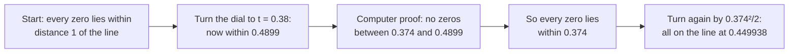

# A heat dial for zeros: proven bounds below 1/2 in degree two

**Some famous functions come with a "heat dial" that pushes all their zeros onto one line. Classical theory says a
setting of 1/2 is always enough. For the function of the modular form η(z)η(23z) we proved that 0.449938 is enough. We
found no earlier bound below 1/2 for a function of this kind ("degree 2"). The proof was checked by AI reviewers,
not yet by a human expert. The gain is modest, and nothing here bears on the Riemann hypothesis itself.**

**Moki & Julio · 2026** · DOI [10.5281/zenodo.23794434](https://doi.org/10.5281/zenodo.23794434) (v1.0)

**Read** [NOTE.md](NOTE.md) · **Re-run** [bundle/README.md](bundle/README.md) · **Check how far each claim is
checked** [bundle/STATUS.md](bundle/STATUS.md)

## The story in a minute

Number theorists study **L-functions**: functions built from whole numbers, the best known being the Riemann zeta
function 1 + 1/2^s + 1/3^s + 1/4^s + ... . The places where such a function equals zero, its **zeros**, are where the
famous questions live. The Riemann hypothesis, and its "generalised" version for other L-functions, are statements about
where those zeros sit.

Every L-function carries a **heat dial** t. Turning the dial up smooths the function and pushes its zeros onto one line.
The smallest setting at which every zero already sits on the line is called the **de Bruijn-Newman constant** Λ. It is
known that Λ ≥ 0, and classical theory gives Λ ≤ 1/2 for free. The generalised Riemann hypothesis for that L-function
says Λ ≤ 0.

A picture that helps (it is only a picture): think of the function as a bumpy landscape, and of the dial as letting heat
spread through it, so that the bumps flatten out. Where the picture breaks: the zeros live in the complex plane, a flat
map of numbers with two coordinates, and "onto the line" means onto one straight line on that map. The smoothing is an
exact mathematical operation (a heat flow), not a temperature.

Bounds below 1/2 were known only in "degree 1": the Riemann zeta function, and, since October 2026, another family of
degree-1 L-functions (built from "real Dirichlet characters"; in a preprint). We proved **Λ ≤ 0.449938** for the degree-2
L-function of the modular form η(z)η(23z), and Λ ≤ 0.489938 for that of η(2z)η(22z). A modular form is a function with
a very large family of symmetries; η is a classical function named after Dedekind; and "degree" is one way
mathematicians sort L-functions into families. We found no earlier bound below 1/2 in degree 2.

A short product lemma, which is an application of known theorems (Lieb-Sokal 1981 and Borcea-Brändén) and claims nothing
new, then gives the first such bounds for the zeta functions of some number fields (at our search floor; the quadratic
and sextic ones rest on an unrefereed 2026 preprint). The gains over 1/2 are modest and
**nothing here bears on the Riemann hypothesis itself**. The proofs were checked by independent AI reviewers, **not yet by
a human expert**.

## Climb the ladder

### Step 1 - the idea (for anyone)

A toy example shows the dial at work. The polynomial x² + 1 has no zeros on the real line: its zeros are the imaginary
numbers i and -i. For polynomials the heat dial is an exact rule; it turns x² - 1 into x² - 1 - 2t (the note's own
example), and in the same way it turns x² + 1 into x² + 1 - 2t. At t = 1/2 the two zeros meet at 0, and for larger t
both are real. So for this toy Λ = 1/2 exactly. The lab uses it as a check that its program gives the right answer.

For the real L-function the argument has two turns of the dial, with a computer proof in between.



The first and last arrows use a 1950 theorem of de Bruijn (in the form given by Dobner). The middle step is the new work.

### Step 2 - how it works (for a curious student)

**De Bruijn's rule.** If every zero lies within distance Δ of the line, then after turning the dial by t it lies within
the square root of Δ² - 2t. So a further turn of Δ²/2 puts every zero on the line. The classical start is Δ = 1, which
gives the free bound 1/2.

**The worked example, with the real numbers.**

1. Turn the dial to t = 0.38. The rule gives a distance of at most √(1 - 0.76) = √6/5 = 0.4898979...
2. Prove by computer that, at t = 0.38, there are no zeros at distance between 0.374 and the top of that band.
3. Now every zero lies within 0.374. Turn again: t = 0.38 + 0.374²/2 = 0.38 + 0.069938 = **0.449938**.

**How a computer proves "no zeros here".** Walk around the edge of a rectangle and watch where the function's value
points. The number of times it turns around zero equals the number of zeros inside (the **winding number**). Every value
is computed in **ball arithmetic**: each number carries a guaranteed error bar, so the count cannot skip a turn.

- Near region, 0 ≤ x ≤ 12,500: winding number 0, from 196,660 certified evaluations over 87 walks (13.4 hours on 9 cores).
- Far region, x ≥ 12,500: a written estimate (the "tail lemma") shows that the first term of the series outweighs the
  error terms. It is checked in interval boxes up to x = 2·10^12 and by a monotonicity argument beyond.
- Below the line: the function is symmetric, so the lower half mirrors the upper half.

**Checks that the walker can see zeros.** Around a box known to hold zeros it must find them, and it does: winding 2 on
[5, 15] × [-1/5, 1/5], and winding 5 on [12496, 12500] × [-1/2, 1/2], equal to 5 sign changes counted by an independent
method that shares no code. A walk straight through one of those zeros is refused ("cannot certify step"), as it must be.

### Step 3 - the real thing (for specialists)

- **Theorem 1 (PROVED, AI-refereed; unconditional, no GRH).** (a) For f_23 = η(z)η(23z) (LMFDB 23.1.b.a, L(s, f_23) =
  L(s, ψ) for the order-3 class-group character ψ of Q(√-23)), all zeros of H_t are real for t ≥ 19/50 + (374/1000)²/2 =
  0.449938, so 0 ≤ Λ_ψ ≤ 0.449938. (b) For f_44 = η(2z)η(22z) (44.1.d.a): 0 ≤ Λ_χ ≤ 0.489938.
- **Theorem P (product lemma; known, no novelty claimed).** For kernels of class D, Λ(Φ ∗ Ψ) ≤ max(Λ(Φ), Λ(Ψ), 0); for
  F, G, FG in Dobner's extended Selberg class with γ_FG = γ_F γ_G, Λ_FG ≤ max(Λ_F, Λ_G).
- **Corollaries.** Λ ≤ 953/3200 = 0.2978125 for the Dedekind zeta function of every quadratic field with fundamental
  discriminant 3 ≤ |D| ≤ 400 (CONDITIONAL on the unrefereed preprint of Freire et al., arXiv:2610.27343); Λ ≤ 0.449938 for
  the cubic field Q[x]/(x³ - x - 1) of discriminant -23 (rests on Theorem 1(a) and Platt-Trudgian) and for its sextic
  Galois closure (also conditional on Freire et al.).
- **Novelty** is a search floor (arXiv and Zenodo, 30 October 2026), not a clearance.

Full statements, proofs and every assumption: [NOTE.md](NOTE.md). Status of every claim, with the bundle folder behind
it: [bundle/STATUS.md](bundle/STATUS.md).

## Use it as a tool

Questions this lets you answer:

- Does the computer part of Theorem 1(a) check out on my machine, and does the checker really fail when a piece is missing?
- Does H_t of η(z)η(23z) have zeros inside a rectangle I choose (at the heat setting I give)?
- If two L-functions have known bounds, what does the product lemma give for their product? (Read Corollary P♯ and the
  table in section 4 of [NOTE.md](NOTE.md).)

**Re-run the core checks** (about a minute; a POSIX shell such as bash, Python 3.11 with
`pip install gmpy2==2.3.1 mpmath==1.3.0 numpy==2.4.4`; full instructions, including the PARI/GP checks, in
[bundle/README.md](bundle/README.md)). Some programs rewrite shipped files next to themselves, so work in a fresh clone.

```
git clone https://github.com/Hashirama1337s/debruijn-newman-degree-two
cd debruijn-newman-degree-two/bundle
mkdir -p rb

# combine the 87 stored walks of Theorem 1(a) and check that they tile the boundary exactly
(cd AB/leadA/cert && python -I cert_combine45b.py) > rb/combine.txt
tail -1 rb/combine.txt

# negative test: remove one piece; the combiner must now fail
cp -r AB/leadA/cert rb/negtest && rm rb/negtest/g45_q11000_11050.json
(cd rb/negtest && python -I cert_combine45b.py) > rb/negtest_combine.txt
tail -1 rb/negtest_combine.txt

# low positive control: a box with 2 zeros at t = 19/50
(cd AB/leadA/cert && rm -f g45_p0.ckpt.jsonl g45_p0.json && python -I cert_wind_ckpt.py g45_p0 19 50 1/2 "5,-1/5;15,-1/5;15,1/5;5,1/5;5,-1/5" 30 25 > ../../../rb/g45_p0.log 2>&1)
tail -1 rb/g45_p0.log
```

You should see:

```
BAR-A14 MAIN (AMEND1 combine) => HOLDS
BAR-A14 MAIN (AMEND1 combine) => FAILED
DONE g45_p0 argsum 12.566370614359172 +- 5.059449524057008e-17 points 66
```

The argsum is the total turning of the function's value, in radians: 12.566... = 4π, two full turns, so two zeros. The
high-x control (winding 5, about 6 minutes) and the tail-lemma re-derivation are in Tier 1 of
[bundle/README.md](bundle/README.md).

**Count zeros in your own rectangle.** The certified walker takes a heat setting t = tnum/tden and a closed path of
corner points "x,y;x,y;...":

```
cd AB/leadA/cert
python -I cert_wind_ckpt.py mybox 19 50 1/2 "5,0.374;15,0.374;15,0.5;5,0.5;5,0.374" 30 25
```

The arguments are: a name; t as tnum and tden (19 50 means t = 0.38); the largest height ymax the evaluator must cover
(1/2); the path; and two tuning values, a step constant c = 30 and a chunk length 25, as in every shipped run.

It prints `DONE mybox argsum A +- r`; the winding number is A / 2π. This example walks around a small piece of the band
that Theorem 1(a) proves empty, so A comes out as 0 within its error bar r: no zeros there.

It writes `mybox.json` and `mybox.ckpt.jsonl`, and resumes from the checkpoint if one exists, so delete both before
re-running a name. Limits: it evaluates only the function of η(z)η(23z); it is slow far out (the 87 walks took 13.4
hours); and it stops with "cannot certify step" rather than guess, for example when the path passes through a zero.

## What we did not show

- **No human expert has checked any of it.** All reviewers are AI reviewers. The tail lemma and the evaluator of
  Theorem 1(a) had a single full review; Theorem 1(b) had one review of a pipeline shared with (a); Theorem P had one full
  review plus a check of the identity and sign only.
- Nothing here bears on the Riemann hypothesis. The gains over 1/2 are modest, and far weaker than the degree-1 bounds.
- The quadratic-field corollary (and the multiquadratic and sextic ones) rest on an unrefereed 2026 preprint.
- For Lieb-Sokal (1981) only the abstract was read; their integrability hypotheses were not checked against these kernels.
  The proof written out in the note uses Borcea-Brändén instead.
- The clean-room rebuild (15/15 checks) did not re-run the 87 walks (about 120 CPU-hours), the tail interval runs, the
  Theorem 1(b) runs or the outlook runs; it re-combined and re-checked the stored walks.
- The outlook in section 5 (a degree-2 effective formula) is HEURISTIC: nothing is claimed and no forecast is made.
- Failures are on record: the first tail run FAILED on a code gap and was re-run under a sealed amendment; a sealed
  wall-time prediction was missed (the run was faster); one outlook run lost its output to a writer bug.
- "We found no earlier bound" is a search floor (arXiv and Zenodo, 30 October 2026), not a clearance.

## Words you will meet

- **L-function** - a function built from whole numbers (or from a modular form), such as the Riemann zeta function.
- **Zero** - a point where the function equals 0. These points live in the complex plane.
- **Complex plane** - a flat map of numbers with two coordinates, x (real part) and y (imaginary part).
- **Heat dial (heat flow)** - an exact smoothing of the function, controlled by a number t.
- **de Bruijn-Newman constant Λ** - the smallest t at which every zero sits on the line.
- **Degree** - one way of sorting L-functions into families; zeta has degree 1, the functions here have degree 2.
- **Modular form; η** - a function with a very large family of symmetries; η is Dedekind's eta function, a classical
  building block of such forms.
- **Dedekind zeta function** - the zeta function of a number field (a number system such as the rationals with √-23 added).
- **Winding number** - how many times a function's value turns around zero along a closed path; it counts the zeros inside.
- **Ball (interval) arithmetic** - computing with numbers that carry guaranteed error bars.
- **Sealed prediction** - a pass/fail bar written down and hashed before the run.
- **Search floor** - a dated search of named sources; not proof that nobody did it before.

---

## For specialists: the original README

# Explicit de Bruijn–Newman bounds below 1/2 in degree 2, and a product lemma for Dedekind zeta functions

**Moki & Julio · 2026** · DOI [10.5281/zenodo.23794434](https://doi.org/10.5281/zenodo.23794434) (v1.0)

The note is [NOTE.md](NOTE.md). The code, sealed predictions, reports and checks behind it are in [bundle/](bundle/) (start with
[bundle/README.md](bundle/README.md); public status table: [bundle/STATUS.md](bundle/STATUS.md)).

## In plain words

Every L-function carries a "heat dial" t. Turning the dial up smooths the function and pushes its zeros onto one line. The smallest
setting at which every zero already sits on the line is the de Bruijn–Newman constant Λ. The generalised Riemann hypothesis for that
L-function says Λ ≤ 0; it is known that Λ ≥ 0, and classical theory gives Λ ≤ 1/2 for free. Bounds below 1/2 were known only in "degree 1"
(the Riemann zeta function, and since October 2026 real Dirichlet characters of small conductor, in a preprint).

- We prove Λ ≤ 0.449938 for the degree-2 L-function of the modular form η(z)η(23z), and Λ ≤ 0.489938 for that of η(2z)η(22z). We found no
  earlier bound below 1/2 in degree 2.
- A short product lemma (an application of Lieb–Sokal 1981 and Borcea–Brändén; nothing new claimed for it) turns known bounds into the
  first bounds below 1/2 for Dedekind zeta functions of number fields: Λ ≤ 0.2978 for every quadratic field with discriminant between 3 and
  400 in absolute value (resting on an unrefereed 2026 preprint), and Λ ≤ 0.449938 for the cubic field of discriminant −23 and its degree-6
  Galois closure.

The gains over 1/2 are modest and nothing here bears on the Riemann hypothesis itself. Proofs were checked by independent AI reviewers,
**not yet by a human expert**. Novelty statements are a search floor (arXiv and Zenodo, 30 October 2026), not a clearance.

## Reproduce

See [bundle/README.md](bundle/README.md) for commands and software versions, [bundle/CLEANROOM.md](bundle/CLEANROOM.md) for the clean-room
record (15/15 checks; the 13-hour certified region walks were not re-run), and [bundle/REDACTIONS.md](bundle/REDACTIONS.md) for the files
whose copies were redacted (names and machine paths only) with hashes before and after.

## Licence and citation

Text and data: CC BY 4.0 ([LICENSE](LICENSE)). Code (all .gp, .py and .sh files): MIT ([LICENSE-CODE](LICENSE-CODE)).
Please cite via [CITATION.cff](CITATION.cff).

*Prepared with AI assistance; all results are machine-checked.*
